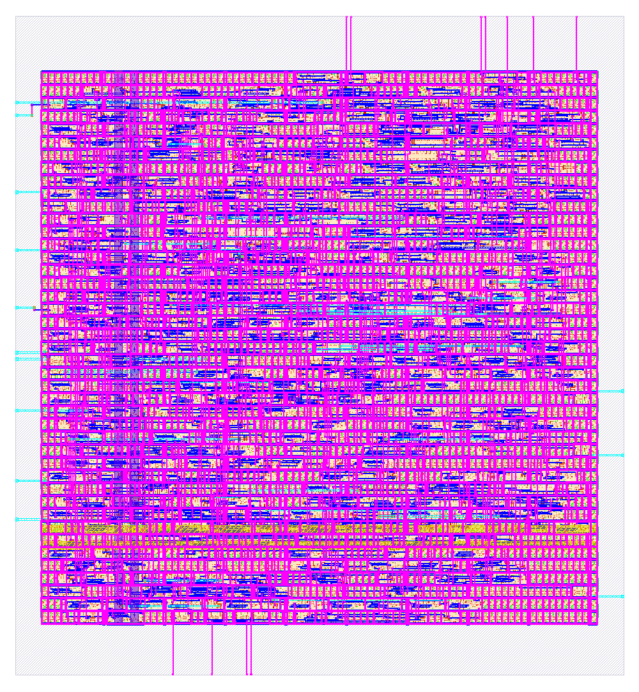
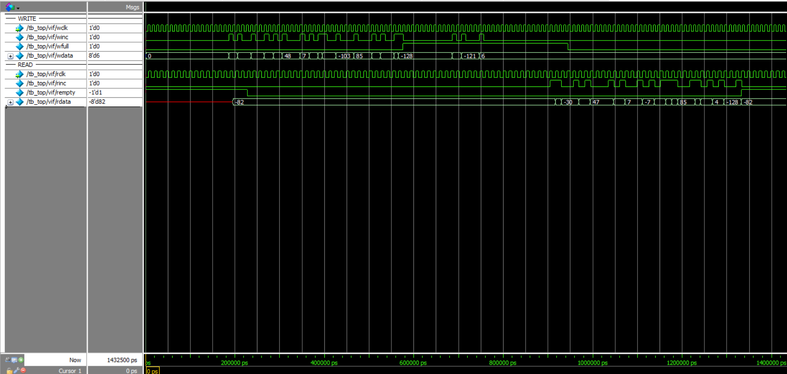

# Asynchronous FIFO: UVM Verification and SKY130 Physical Implementation

A parameterized asynchronous FIFO (default 8-bit x 16 entries) with independent write and read
clocks, verified with a UVM testbench in Questa and implemented from RTL to a routed, DRC/LVS-clean
layout on SkyWater SKY130 using Yosys and LibreLane.

| | |
|---|---|
| Design | Gray-code pointer async FIFO with two-flop synchronizers, 8-bit x 16 |
| Verification | UVM (Questa, UVM 1.1d): 5 tests, scoreboard with reference queue, 0 UVM errors |
| Implementation | LibreLane 3.0.17, SKY130 (sky130A, sky130_fd_sc_hd) |
| Sign-off | DRC, LVS and antenna checks pass; setup and hold met at every analysed corner |

## Architecture
- Read and write pointers are `ADDR_WIDTH+1` bits wide and Gray coded, so only one bit changes per step.
- Each Gray pointer crosses into the other clock domain through a two-flop synchronizer.
- `full` is generated in the write domain; `empty` is generated in the read domain.
- Independent active-low asynchronous resets per domain.

| Module | Role |
|---|---|
| `sync_2ff` | Two-flop synchronizer |
| `fifo_mem` | Dual-port memory (write on wclk, combinational read) |
| `wptr_full` | Write pointer and full flag |
| `rptr_empty` | Read pointer and empty flag |
| `async_fifo` | Top level |

## Verification results (Questa, UVM)
| Test | Scenario | Writes / reads | Result |
|---|---|---|---|
| `basic_rw_test` | write 8, read 8 | 8 / 8 | Pass |
| `fill_full_test` | fill to 16, 3 forced over-writes, drain | 16 / 16 | Pass |
| `drain_empty_test` | drain, 3 forced under-reads, reuse | 10 / 10 | Pass |
| `fast_write_slow_read_test` | 250 MHz write, 50 MHz read, 64 words | 64 / 64 | Pass |
| `slow_write_fast_read_reset_test` | 50 MHz write, 250 MHz read, mid-test reset | 50 / 40 | Pass |

All five report `UVM_ERROR : 0` and `UVM_FATAL : 0`. Logs are in `logs/`.
Details, checks and findings: see `docs/REPORT.md`.

## Physical implementation results (LibreLane, SKY130)
| Metric | Value |
|---|---|
| Clocks | wclk 10 ns, rclk 13 ns (asynchronous groups) |
| Die size | 128.975 x 139.695 um |
| Core utilization | 58.2% |
| Instances | 2395 |
| Worst setup slack | +3.79 ns (slowest corner) |
| Worst hold slack | +0.226 ns (fastest corner) |
| Estimated total power | about 3.27 mW (tool estimate) |
| DRC / LVS / antenna | Pass / Pass / Pass |

Results, netlist, layout and reports are in `docs/results/`.

## Repository layout
    rtl/         synthesizable design
    tb/          UVM testbench (Questa)
    librelane/   LibreLane config and SDC (SKY130)
    logs/        simulation logs of the 5 tests
    docs/        report, results, images
    regress.bat  runs all 5 tests in batch mode (Windows)
    run.do       runs one test in the Questa GUI

## How to run
Simulation (Questa, Windows), from the repository root:

    regress.bat

Single test in the Questa GUI:

    do run.do fill_full_test

Physical flow (Linux or WSL with Docker and LibreLane installed). Clone the repository into your
Linux home folder, then:

    cd librelane
    librelane --dockerized config.json

## Limitations
- No functional coverage collection and no SystemVerilog assertions yet.
- Stimulus uses `$urandom_range`: the Questa Starter Edition has no license for `randomize()`.
- No gate-level simulation with SDF back-annotation.
- The two clock domains are constrained as asynchronous, so synchronizer paths are not timed.

## Author
Chiranthan Gowda S P
